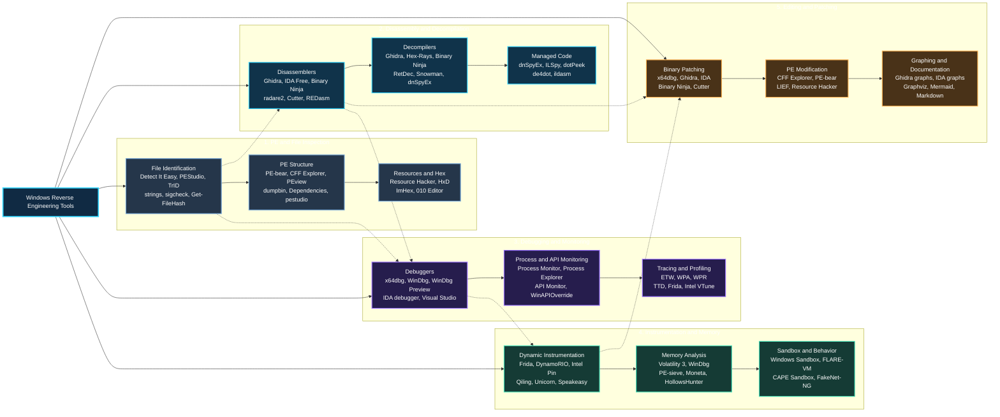

    

        
    

# **`Awesome`** [Windows](https://wikipedia.org/wiki/Machine_code) [Reverse](https://www.apriorit.com/dev-blog/366-software-reverse-engineering-tools) [Engineering](https://wiki.installgentoo.com/wiki/Reverse_Engineering) 

    
    &nbsp;
    
    &nbsp;
    
    

```mermaid
flowchart TB
    ROOT["Windows Reverse Engineering Tool Types"]

    ROOT --> INSPECT["PE and File Inspection<br/>PE-bear, CFF Explorer, PEStudio<br/>Detect It Easy, strings, sigcheck"]
    ROOT --> DISASM["Disassemblers<br/>Ghidra, IDA Free, Binary Ninja<br/>radare2, Cutter, Capstone"]
    ROOT --> DECOMP["Decompilers<br/>Ghidra, Hex-Rays, Binary Ninja<br/>RetDec, Snowman, dnSpyEx"]
    ROOT --> DEBUG["Debuggers<br/>x64dbg, WinDbg, GDB<br/>IDA debugger, Immunity Debugger"]
    ROOT --> TRACE["Tracing and Monitoring<br/>Process Monitor, Process Explorer<br/>API Monitor, ETW, WPA"]
    ROOT --> MEMORY["Memory and Forensics<br/>Volatility 3, WinDbg<br/>PE-sieve, Moneta, HollowsHunter"]
    ROOT --> INSTR["Instrumentation and Emulation<br/>Frida, DynamoRIO, Intel Pin<br/>Qiling, Unicorn, Speakeasy"]
    ROOT --> EDIT["Hex Editing and Patching<br/>HxD, ImHex, 010 Editor<br/>CFF Explorer, PE-bear, LIEF"]

    classDef root fill:#102a43,stroke:#32d5ff,color:#ffffff,stroke-width:3px
    classDef blue fill:#10334a,stroke:#32d5ff,color:#ffffff,stroke-width:2px
    classDef green fill:#123b3c,stroke:#45e0b7,color:#ffffff,stroke-width:2px
    classDef purple fill:#261d4d,stroke:#9a72ff,color:#ffffff,stroke-width:2px
    classDef orange fill:#493218,stroke:#ffb454,color:#ffffff,stroke-width:2px

    class ROOT root
    class INSPECT,DISASM blue
    class DECOMP,INSTR green
    class DEBUG,TRACE purple
    class MEMORY,EDIT orange
```

## 📖 Contents
- [Datasets](#datasets)
- [Scientific Research](#scientific-research)
- [My Other Awesome Lists](#my-other-awesome-lists)
- [Contributing](#contributing)
- [Contributors](#contributors)

## Tools

### [Disassembler](https://wikipedia.org/wiki/Disassembler) Tools
A disassembler is a computer program that translates machine language into assembly language

### [Decompiler](https://wikipedia.org/wiki/Decompiler) Tools
A decompiler is a computer program that translates an executable file back into high-level source code. 

### [Debugging](https://wikipedia.org/wiki/Debugger) Tools
A debugger is a computer program used to test and debug other programs (the "target" programs).

## Training
* [Reverse Engineering 101](https://malwareunicorn.org/workshops/re101.html)
* [Reverse Engineering 102](https://malwareunicorn.org/workshops/re102.html)
* [Malware Reverse Engineering for Beginners](https://intezer.com/blog/malware-reverse-engineering-beginners/)

##

### Datasets
You can access the datasets [here](https://github.com/cybersecurity-dev/awesome-malware-datasets?tab=readme-ov-file#windows).

### Scientific Research
You can access the Scientific Research [here](https://github.com/cybersecurity-dev/awesome-static-windows-malware-analysis-scientific-research).

### My Other Awesome Lists
You can access the my other awesome lists [here](https://cyberthreatdefence.com/my_awesome_lists)

### Contributing
[Contributions of any kind welcome, just follow the guidelines](contributing.md)!

### Contributors
[Thanks goes to these contributors](https://github.com/cybersecurity-dev/awesome-windows-reverse-engineering/graphs/contributors)!

### License

[🔼 Back to top](#awesome-windows-reverse-engineering-)

